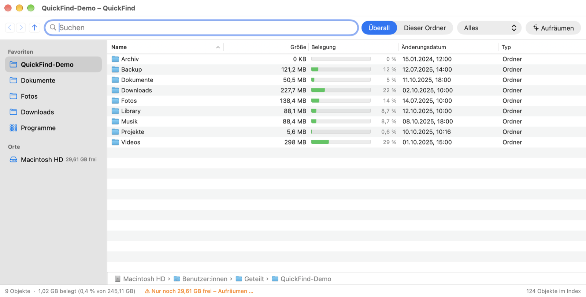
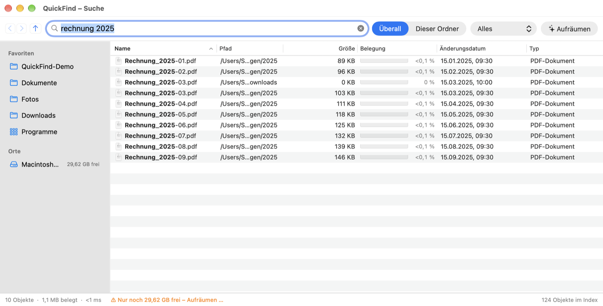
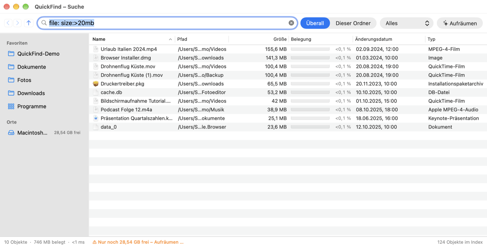
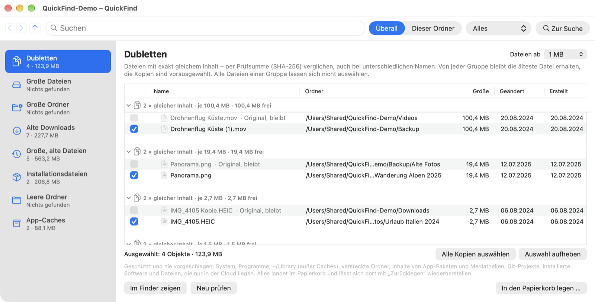

# QuickFind

🇬🇧 [English](README.md) · 🇩🇪 **Deutsch**

**Blitzschnelle Datei- und Ordnernamensuche für macOS, inspiriert von *Everything* (voidtools) unter Windows.**

QuickFind indiziert alle Datei- und Ordnernamen deiner Laufwerke und durchsucht sie schon beim Tippen in wenigen
Millisekunden. Die App ist nativ in Swift mit AppKit geschrieben und kommt **ohne Fremdabhängigkeiten** aus. Sie
arbeitet vollständig lokal, sendet nichts ins Netz und enthält keine Telemetrie.


[](https://github.com/mauzben/QuickFind/actions/workflows/ci.yml)


> **Hinweis:** Bei der Entwicklung von QuickFind wurde der KI-Assistent
> **[Claude Code](https://claude.com/claude-code)** als Werkzeug verwendet.



---

## Inhalt

- [Screenshots](#screenshots)
- [Funktionen](#funktionen)
- [Voraussetzungen](#voraussetzungen)
- [Installation](#installation)
- [Erster Start & Festplattenvollzugriff](#erster-start--festplattenvollzugriff)
- [Bedienung](#bedienung)
- [Suchsyntax](#suchsyntax)
- [Aufräum-Assistent](#aufräum-assistent)
- [Kommandozeile `qf`](#kommandozeile-qf)
- [Messwerte](#messwerte)
- [Architektur](#architektur)
- [Projektstruktur](#projektstruktur)
- [Datenschutz](#datenschutz)
- [Bekannte Grenzen](#bekannte-grenzen)
- [Mitmachen](#mitmachen)
- [Lizenz](#lizenz)
- [Haftungsausschluss](#haftungsausschluss)
- [Marken & Danksagung](#marken--danksagung)

---

## Screenshots

> Alle Screenshots zeigen einen **Demo-Ordner mit erfundenen Beispieldateien**. Sie enthalten keine echten
> persönlichen Daten.

**Suche beim Tippen**: Treffer erscheinen sofort, der Suchbegriff ist fett hervorgehoben.



**Suchsyntax**: Hier alle Dateien über 20 MB (`file: size:>20mb`), absteigend nach Größe sortiert.



**Aufräum-Assistent**: Dubletten mit identischem Inhalt (SHA-256). Das Original bleibt immer erhalten.



---

## Funktionen

### Suche
- **Suche beim Tippen** über alle Datei- und Ordnernamen, Treffer **fett hervorgehoben**
- Suchsyntax im Stil von Everything: UND, ODER, NICHT, Phrasen, Platzhalter, Regex sowie Filter nach Größe, Datum,
  Endung und Pfad (siehe [Suchsyntax](#suchsyntax))
- Schnellfilter: Audio, Archive, Dokumente, Programme, Ordner, Bilder, Videos
- **Suchbereich** „Überall“ oder „Dieser Ordner“ (inkl. Unterordner)
- **Live-Updates** per FSEvents. Änderungen seit dem letzten Lauf werden beim Start nachgeholt, ein Neuscan ist nicht nötig.

### Finder-ähnliche Oberfläche
- **Ordneransicht wie im Finder**, solange kein Suchbegriff eingegeben ist: Doppelklick öffnet Ordner, dazu
  Zurück/Vor/Nach oben, Pfadleiste, Menü „Gehe zu“ mit den Finder-Kurzbefehlen und versteckte Dateien per ⇧⌘.
- **Seitenleiste** mit Favoriten (per Drag & Drop oder Rechtsklick hinzufügen) und allen Laufwerken mit freiem
  Speicher, ein-/ausblenden mit ⌥⌘S
- Spalten **Name, Pfad, Größe, Belegung, Änderungsdatum, Typ**, optional **Erstellt am**, **Zuletzt geöffnet** und
  **Finder-Tags** (Rechtsklick auf die Spaltenüberschrift)
- Sortierung wie im Finder: Umlaute korrekt, Zahlen natürlich („Datei2“ vor „Datei10“)
- **Ordnergrößen** als Summe des gesamten Inhalts, live aktualisiert
- **Belegung** mit Balkenanzeige. Sparse-Dateien (z. B. `Docker.raw`), APFS-Kompression und reine Online-Dateien aus
  der Cloud zählen mit ihrem echten Platzbedarf.
- **Dateien bearbeiten**: Umbenennen (F2), neuer Ordner (⇧⌘N), Kopieren/Einsetzen (⌘C/⌘V), Bewegen (⌥⌘V),
  in den Papierkorb (⌘⌫), Drag & Drop in Ordner und andere Apps
- **Quick Look** mit der Leertaste, Kontextmenü, Öffnen (↩), Im Finder zeigen (⌘↩), Pfad kopieren (⌥⌘C)

### Speicherplatz
- Analysen: Ordnerinhalt nach Größe, größte Dateien, Dubletten, große alte Dateien
- **Aufräum-Assistent** mit inhaltsbasierter Dublettensuche (SHA-256) und strengen Schutzregeln
  (siehe [Aufräum-Assistent](#aufräum-assistent))

### System
- **Globaler Kurzbefehl** (Standard: ⌃⌥Leertaste, frei wählbar)
- Symbol in der Menüleiste, Dock-Symbol abschaltbar
- **Autostart bei der Anmeldung** (still in der Menüleiste)
- Ausgeschlossene Ordner; externe Volumes optional, werden beim Ein- und Aushängen automatisch erkannt

---

## Voraussetzungen

- **macOS 13 Ventura** oder neuer (Apple Silicon oder Intel)
- **Swift 5.10+**. Die *Command Line Tools* reichen, Xcode ist nicht nötig:
  ```bash
  xcode-select --install
  ```

---

## Installation

QuickFind wird aus dem Quellcode gebaut.

```bash
git clone https://github.com/mauzben/QuickFind.git
cd QuickFind
./scripts/build-app.sh
```

Danach `build/app.noindex/QuickFind.app` nach `/Programme` ziehen und starten.

**Alternativ als Installations-Image:**

```bash
./scripts/make-dmg.sh      # erzeugt build/QuickFind-<Version>.dmg
```

DMG öffnen und QuickFind auf den Ordner „Programme“ ziehen.

### Optional: Festplattenvollzugriff über Updates hinweg behalten

```bash
./scripts/create-signing-identity.sh   # einmalig
```

Das Skript legt im Anmelde-Schlüsselbund ein selbstsigniertes Zertifikat „QuickFind Local Signing“ an, das nur auf
deinem Mac gilt. `build-app.sh` signiert damit automatisch. macOS erkennt neue Builds so als dieselbe App, und du musst
den Festplattenvollzugriff nur einmal erteilen. Ohne Zertifikat wird die App ad-hoc signiert.

> **Hinweis:** Die App ist nicht von Apple notarisiert. Lädst du eine fertige DMG aus dem Internet, blockiert macOS
> den ersten Start. Erlaube ihn unter *Systemeinstellungen → Datenschutz & Sicherheit → „Trotzdem öffnen“*
> (bis macOS 14 genügt Rechtsklick → *Öffnen*). Wenn du selbst baust, entfällt dieser Schritt.

---

## Erster Start & Festplattenvollzugriff

Damit QuickFind wirklich **alle** Dateien findet, braucht die App den **Festplattenvollzugriff**:

1. QuickFind starten. Die App fragt beim ersten Start danach.
2. *Systemeinstellungen → Datenschutz & Sicherheit → Festplattenvollzugriff* öffnen.
3. **QuickFind** einschalten und die App neu starten.

Danach baut QuickFind einmalig den Index auf. Ab dann startet die App sofort, und Änderungen werden live übernommen.
Ohne Vollzugriff fehlen geschützte Ordner, und macOS fragt für einzelne Ordner nach.

Der Index liegt unter `~/Library/Application Support/QuickFind/`.

---

## Bedienung

| Aktion | Tastenkürzel |
|---|---|
| QuickFind von überall aufrufen | ⌃⌥Leertaste (änderbar) |
| Öffnen | ↩ |
| Im Finder zeigen | ⌘↩ |
| Quick Look | Leertaste |
| Umbenennen | F2 |
| Neuer Ordner | ⇧⌘N |
| Kopieren / Einsetzen / Bewegen | ⌘C / ⌘V / ⌥⌘V |
| Pfad kopieren | ⌥⌘C |
| In den Papierkorb | ⌘⌫ |
| Seitenleiste ein/aus | ⌥⌘S |
| Versteckte Dateien ein/aus | ⇧⌘. |
| Aufräum-Assistent | ⌃⌘0 |

Die vollständige Suchsyntax findest du in der App unter *Hilfe → Suchsyntax*.

---

## Suchsyntax

| Eingabe | Bedeutung |
|---|---|
| `foo bar` | Name enthält `foo` **und** `bar` |
| `foo \| bar` | `foo` **oder** `bar` |
| `!foo` | **nicht** `foo` |
| `"genaue phrase"` | Phrase inkl. Leerzeichen |
| `*.jpg`, `bild?.png` | Platzhalter |
| `ext:pdf;docx` | Dateiendung(en) |
| `file:` / `folder:` | nur Dateien / nur Ordner |
| `case:` | Groß-/Kleinschreibung beachten |
| `ww:` | ganze Wörter |
| `path:` | im ganzen Pfad suchen (automatisch, wenn `/` vorkommt) |
| `regex:` | regulärer Ausdruck |
| `size:>10mb`, `size:huge` | Größe (gilt auch für Ordner) |
| `dm:today`, `dm:2024`, `dm:>2025-01-01` | Änderungsdatum |
| `dc:` | Erstellungsdatum |
| `dupe:` | Dubletten (gleicher Name und gleiche Größe) |

**Beispiele:**

```text
ext:pdf rechnung dm:2025          PDF-Rechnungen aus 2025
folder: node_modules              alle node_modules-Ordner
size:>1gb !ext:dmg                große Dateien außer Disk-Images
Projekte/ readme                  README-Dateien in Ordnern namens „Projekte“
```

---

## Aufräum-Assistent

Erreichbar über die Schaltfläche „Aufräumen“ oder ⌃⌘0. Der Assistent schlägt vor:

- **Dubletten mit identischem Inhalt** (SHA-256, unabhängig vom Namen). Eine Kopie bleibt immer erhalten.
- Große Dateien und große Ordner
- Alte Downloads und große alte Dateien
- Installationsdateien (`.dmg`, `.pkg` …)
- Leere Ordner und App-Caches

**Schutzregeln:** Nie vorgeschlagen werden System, Programme, `~/Library` (außer Caches), versteckte Ordner,
App-Pakete und Mediatheken, Git-Projekte, installierte Software, Cloud-Dateien sowie Hauptordner wie Dokumente als
Ganzes. Was du auswählst, wird erst **nach Bestätigung** in den **Papierkorb** verschoben, nicht endgültig gelöscht.

> Prüfe Vorschläge trotzdem immer selbst, bevor du sie entfernst (siehe [Haftungsausschluss](#haftungsausschluss)).

---

## Kommandozeile `qf`

`build-app.sh` erzeugt zusätzlich das Kommandozeilenwerkzeug `build/qf` zum Testen und Messen:

```bash
build/qf selftest                                   # 77 End-to-End-Tests inkl. FSEvents-Live-Updates
build/qf bench --synthetic 3000000                  # Suchgeschwindigkeit mit 3 Mio. Einträgen
build/qf scan --root /Applications --store /tmp/x.qfi
build/qf search "ext:pdf rechnung" --store /tmp/x.qfi --sort size --desc
build/qf watch --root ~/Downloads --seconds 30      # Live-Änderungen beobachten
```

**Entwickler-Variablen der App:**

| Variable | Wirkung |
|---|---|
| `QF_ROOTS=/a:/b` | nur diese Ordner indizieren |
| `QF_STORE=datei` | eigener Speicherort für den Index |
| `QF_QUERY=text` | Startsuche |
| `QF_FOLDER=pfad` | Startordner |
| `QF_SHOW_SETTINGS=1` | Einstellungen beim Start öffnen |
| `QF_SHOW_CLEANUP=1` | Aufräum-Assistent beim Start öffnen |
| `QF_CLEANUP_HOME=pfad` | Aufräum-Assistent auf einem Testordner statt dem Benutzerordner |

---

## Messwerte

Gemessen auf Apple Silicon mit 8 Kernen:

| Vorgang | Dauer |
|---|---|
| Suche in 1,5 Mio. echten Einträgen inkl. Sortierung | 1–15 ms |
| Suche in 3 Mio. synthetischen Einträgen | 6–35 ms (Regex ~0,5 s) |
| Index laden beim Start (1,5 Mio. Einträge) | 20–350 ms |
| Erstscan Datenvolume | ~350.000 Einträge/s |
| Erstscan versiegeltes Systemvolume (`/System`) | ~120.000 Einträge/s |
| Arbeitsspeicher | ~100 Byte pro Eintrag |

---

## Architektur

Everything liest unter Windows die NTFS-MFT direkt aus und verfolgt Änderungen über das USN-Journal. QuickFind
überträgt dieses Prinzip auf macOS und APFS:

| Everything (Windows/NTFS) | QuickFind (macOS/APFS) |
|---|---|
| MFT direkt auslesen | parallele Verzeichnis-Enumeration mit `getattrlistbulk()` |
| USN-Journal | **FSEvents** für Live-Änderungen |
| USN-Replay nach Neustart | FSEvents-**Event-ID-Replay** (`sinceWhen`) |
| `Everything.db` | binärer Index-Snapshot, lädt in ~100 ms |
| kompakter In-Memory-Index | Struct-of-Arrays: ein großer Namenspuffer plus Offsets, Eltern-IDs, Größe, Datum, Flags |
| lineare Suche | `memmem` über den Namenspuffer, parallel auf allen Kernen |
| vorsortierte Indizes | vorberechnete Namensreihenfolge, Sortieren nach Name in O(n) |

Details stehen in [docs/ARCHITECTURE.md](docs/ARCHITECTURE.md) (auf Englisch).

## Projektstruktur

```text
QuickFind/
├─ Package.swift                Swift-Package (3 Targets)
├─ Sources/
│  ├─ QuickFindCore/            Bibliothek: Index, Scanner, FSEvents, Suche, Persistenz, Aufräumlogik, Selbsttests
│  ├─ QuickFind/                AppKit-App: Fenster, Ergebnisliste, Seitenleiste, Einstellungen, Aufräum-Assistent
│  └─ qf/                       Kommandozeilenwerkzeug
├─ Resources/
│  ├─ Info.plist                App-Bundle-Metadaten
│  └─ en.lproj, de.lproj        Übersetzungen der Oberfläche (Schlüssel = deutscher Text)
├─ scripts/
│  ├─ build-app.sh              baut QuickFind.app und qf nach ./build
│  ├─ make-dmg.sh               erzeugt ein Installations-Image
│  ├─ make-icon.swift           zeichnet das App-Symbol per Code
│  └─ create-signing-identity.sh  optionales lokales Signier-Zertifikat
├─ .github/workflows/ci.yml    baut und testet jeden Push und Pull Request
└─ docs/
   ├─ ARCHITECTURE.md           Architektur und technische Details (Englisch)
   └─ screenshots/              Bilder für die READMEs (Demo-Daten; en/ = Englisch)
```

---

## Datenschutz

- QuickFind arbeitet **vollständig offline**. Es gibt keine Netzwerkzugriffe, keine Telemetrie und keine Analytics.
- Der Index enthält nur Datei- und Ordnernamen sowie Metadaten (Größe, Datum, Flags), **keine Dateiinhalte**.
  Er liegt ausschließlich lokal unter `~/Library/Application Support/QuickFind/`.
- Nur der Aufräum-Assistent liest Dateiinhalte, um Prüfsummen (SHA-256) für die Dublettensuche zu berechnen, und auch
  das nur lokal.

---

## Bekannte Grenzen

- Der **erste** Vollscan ist langsamer als bei Everything, weil Apple keinen direkten Zugriff auf die
  APFS-Metadaten bietet. Danach startet QuickFind dank Snapshot und FSEvents-Replay sofort.
- Ohne **Festplattenvollzugriff** bleibt der Index unvollständig.
- Die App ist nicht notarisiert (siehe [Installation](#installation)).
- Die Oberfläche gibt es auf **Deutsch** und **Englisch**. Sie folgt der Sprache von macOS.

---

## Mitmachen

Fehlermeldungen, Ideen und Pull Requests sind willkommen.

1. Issue eröffnen oder Repository forken
2. Änderung umsetzen und `swift build && .build/debug/qf selftest` ausführen
3. Pull Request stellen

Neue Texte der Oberfläche werden auf Deutsch geschrieben und in `L("…")` eingeschlossen. Bitte die englische
Übersetzung in `Resources/en.lproj/Localizable.strings` ergänzen.

Mit einem Beitrag erklärst du dich einverstanden, dass er unter derselben Lizenz wie das Projekt veröffentlicht
wird (GNU GPL v3 oder neuer). Der Projektinhaber darf ihn zusätzlich unter anderen Bedingungen lizenzieren.

---

## Lizenz

QuickFind ist freie Software unter der **[GNU General Public License v3.0](LICENSE)** (oder einer neueren Version).
Copyright © 2026 mauzben.

**Erlaubt:** Nutzen, Untersuchen, Ändern und Weitergeben, auch in veränderter Form.

**Bedingung:** Wer QuickFind oder darauf aufbauende Software weitergibt, muss den vollständigen Quellcode ebenfalls
unter der GPL v3 bereitstellen und die Copyright-Hinweise aus [NOTICE](NOTICE) beibehalten. Ein Einbau in
**proprietäre (Closed-Source-)Produkte ist damit nicht erlaubt**.

Für eine Nutzung außerhalb der GPL, etwa in einem Closed-Source-Produkt, ist eine separate kommerzielle Lizenz nötig.
Dafür bitte ein Issue eröffnen.

---

## Haftungsausschluss

QuickFind wird **„wie besehen“ (as is)** bereitgestellt, **ohne jede Gewährleistung**. Soweit gesetzlich zulässig,
haftet der Urheber nicht für Schäden, die aus der Nutzung entstehen, insbesondere nicht für Datenverlust durch
Umbenennen, Verschieben oder Löschen von Dateien oder durch den Aufräum-Assistenten. Maßgeblich sind die
Abschnitte 15 und 16 der [Lizenz](LICENSE). **Erstelle vor dem Aufräumen ein Backup**, z. B. mit Time Machine.

---

## Marken & Danksagung

- Bei der Entwicklung wurde **[Claude Code](https://claude.com/claude-code)** als KI-Werkzeug verwendet.
- Die Idee stammt von **[Everything](https://www.voidtools.com)** von voidtools. QuickFind ist eine **unabhängige
  Neuentwicklung**, enthält keinen Code von Everything und steht in **keiner Verbindung** zu voidtools.
- Apple, macOS, Finder, Spotlight und Quick Look sind Marken von Apple Inc. QuickFind steht in keiner Verbindung zu
  Apple. Alle Marken gehören ihren jeweiligen Inhabern.
