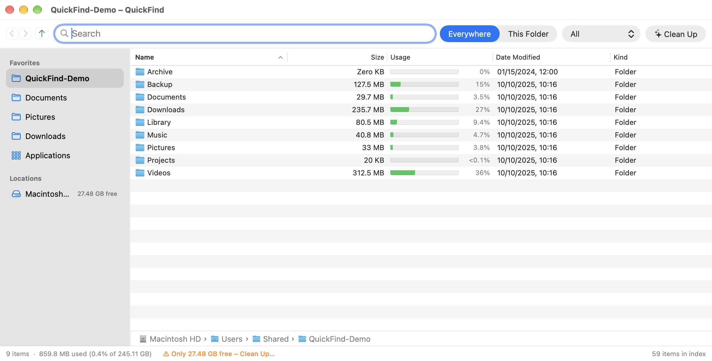
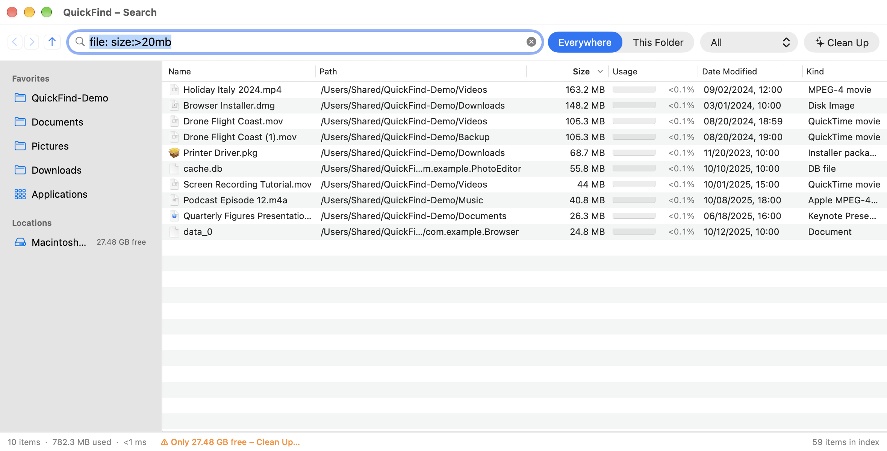
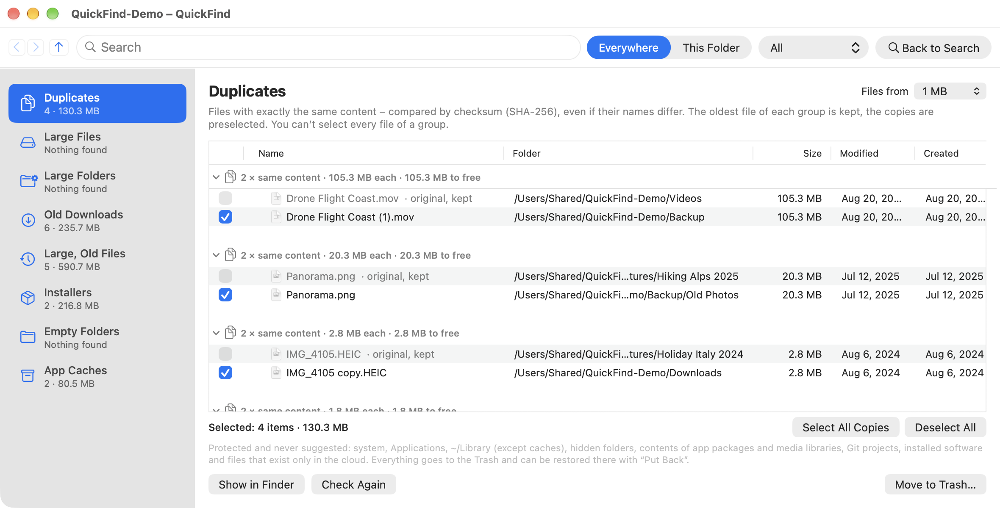

# QuickFind

🇬🇧 **English** · 🇩🇪 [Deutsch](README.de.md)

**Lightning-fast file and folder name search for macOS, inspired by *Everything* (voidtools) on Windows.**

QuickFind indexes the names of all files and folders on your drives and searches them as you type, in a few
milliseconds. The app is written natively in Swift with AppKit and has **no third-party dependencies**. It works
entirely locally, sends nothing over the network and contains no telemetry.


[](https://github.com/mauzben/QuickFind/actions/workflows/ci.yml)


> **Note:** The AI assistant **[Claude Code](https://claude.com/claude-code)** was used as a tool during the
> development of QuickFind.



---

## Contents

- [Screenshots](#screenshots)
- [Features](#features)
- [Requirements](#requirements)
- [Installation](#installation)
- [First launch & Full Disk Access](#first-launch--full-disk-access)
- [Usage](#usage)
- [Search syntax](#search-syntax)
- [Clean-up assistant](#clean-up-assistant)
- [Command line tool `qf`](#command-line-tool-qf)
- [Benchmarks](#benchmarks)
- [Architecture](#architecture)
- [Project structure](#project-structure)
- [Privacy](#privacy)
- [Known limitations](#known-limitations)
- [Contributing](#contributing)
- [License](#license)
- [Disclaimer](#disclaimer)
- [Trademarks & acknowledgements](#trademarks--acknowledgements)

---

## Screenshots

> All screenshots show a **demo folder with made-up sample files** and no real personal data.

**Search as you type**: results appear instantly, the search term is highlighted in bold.


**Search syntax**: all files over 20 MB (`file: size:>20mb`), sorted by size in descending order.



**Clean-up assistant**: duplicates with identical content (SHA-256). The original is always kept.



---

## Features

### Search
- **Search as you type** across all file and folder names, matches **highlighted in bold**
- Everything-style search syntax: AND, OR, NOT, phrases, wildcards, regex and filters by size, date, extension and
  path (see [Search syntax](#search-syntax))
- Quick filters: audio, archives, documents, applications, folders, pictures, videos
- **Search scope** “Everywhere” or “This Folder” (including subfolders)
- **Live updates** via FSEvents. Changes since the last run are caught up at launch, no rescan needed.

### Finder-like interface
- **Folder view like in Finder** while the search field is empty: double-click opens folders, plus Back/Forward/Up,
  path bar, a “Go” menu with the Finder shortcuts and hidden files via ⇧⌘.
- **Sidebar** with favorites (add them via drag & drop or right-click) and all drives with their free space,
  show/hide with ⌥⌘S
- Columns **Name, Path, Size, Usage, Date Modified, Kind**, optionally **Date Created**, **Last Opened** and
  **Finder tags** (right-click the column header)
- Sorting like in Finder: accents handled correctly, numbers sorted naturally (“File2” before “File10”)
- **Folder sizes** as the total of their entire contents, updated live
- **Usage** with a bar chart. Sparse files (e.g. `Docker.raw`), APFS compression and online-only cloud files count
  with the space they really take up.
- **File operations**: rename (F2), new folder (⇧⌘N), copy/paste (⌘C/⌘V), move (⌥⌘V), move to Trash (⌘⌫),
  drag & drop into folders and other apps
- **Quick Look** with the space bar, context menu, open (↩), show in Finder (⌘↩), copy path (⌥⌘C)

### Storage
- Analyses: folder contents by size, largest files, duplicates, large old files
- **Clean-up assistant** with content-based duplicate detection (SHA-256) and strict protection rules
  (see [Clean-up assistant](#clean-up-assistant))

### System
- **Global shortcut** (default: ⌃⌥Space, freely configurable)
- Menu bar icon, Dock icon can be turned off
- **Open at login** (quietly in the menu bar)
- Excluded folders; external volumes optional and detected automatically when mounted or ejected
- Interface in **English** and **German**, following the macOS language setting

---

## Requirements

- **macOS 13 Ventura** or later (Apple silicon or Intel)
- **Swift 5.10+**. The *Command Line Tools* are enough, Xcode is not required:
  ```bash
  xcode-select --install
  ```

---

## Installation

QuickFind is built from source.

```bash
git clone https://github.com/mauzben/QuickFind.git
cd QuickFind
./scripts/build-app.sh
```

Then drag `build/app.noindex/QuickFind.app` into `/Applications` and open it.

**Alternatively as a disk image:**

```bash
./scripts/make-dmg.sh      # creates build/QuickFind-<version>.dmg
```

Open the DMG and drag QuickFind onto the Applications folder.

### Optional: keep Full Disk Access across updates

```bash
./scripts/create-signing-identity.sh   # once
```

The script creates a self-signed certificate “QuickFind Local Signing” in your login keychain that is only valid on
your Mac. `build-app.sh` uses it automatically. macOS then recognizes new builds as the same app, so you only have to
grant Full Disk Access once. Without the certificate the app is signed ad hoc.

> **Note:** The app is not notarized by Apple. If you download a prebuilt DMG from the internet, macOS blocks the
> first launch. Allow it under *System Settings → Privacy & Security → “Open Anyway”* (up to macOS 14, right-click →
> *Open* is enough). If you build it yourself, this step is not needed.

---

## First launch & Full Disk Access

For QuickFind to really find **all** files, the app needs **Full Disk Access**:

1. Open QuickFind. It asks for access on first launch.
2. Open *System Settings → Privacy & Security → Full Disk Access*.
3. Turn on **QuickFind** and restart the app.

QuickFind then builds its index once. From then on it starts instantly and picks up changes live. Without Full Disk
Access, protected folders are missing and macOS asks for individual folders.

The index is stored in `~/Library/Application Support/QuickFind/`.

---

## Usage

| Action | Shortcut |
|---|---|
| Open QuickFind from anywhere | ⌃⌥Space (configurable) |
| Open | ↩ |
| Show in Finder | ⌘↩ |
| Quick Look | Space |
| Rename | F2 |
| New folder | ⇧⌘N |
| Copy / paste / move | ⌘C / ⌘V / ⌥⌘V |
| Copy path | ⌥⌘C |
| Move to Trash | ⌘⌫ |
| Show/hide sidebar | ⌥⌘S |
| Show/hide hidden files | ⇧⌘. |
| Clean-up assistant | ⌃⌘0 |

The complete search syntax is available in the app under *Help → Search Syntax*.

---

## Search syntax

| Input | Meaning |
|---|---|
| `foo bar` | name contains `foo` **and** `bar` |
| `foo \| bar` | `foo` **or** `bar` |
| `!foo` | **not** `foo` |
| `"exact phrase"` | phrase including spaces |
| `*.jpg`, `photo?.png` | wildcards |
| `ext:pdf;docx` | file extension(s) |
| `file:` / `folder:` | files only / folders only |
| `case:` | match case |
| `ww:` | whole words |
| `path:` | search the full path (automatic if the term contains `/`) |
| `regex:` | regular expression |
| `size:>10mb`, `size:huge` | size (also applies to folders) |
| `dm:today`, `dm:2024`, `dm:>2025-01-01` | date modified |
| `dc:` | date created |
| `dupe:` | duplicates (same name and same size) |

**Examples:**

```text
ext:pdf invoice dm:2025           PDF invoices from 2025
folder: node_modules              all node_modules folders
size:>1gb !ext:dmg                large files except disk images
projects/ readme                  README files in folders named “projects”
```

---

## Clean-up assistant

Available via the “Clean Up” button or ⌃⌘0. The assistant suggests:

- **Duplicates with identical content** (SHA-256, regardless of name). One copy is always kept.
- Large files and large folders
- Old downloads and large old files
- Installers (`.dmg`, `.pkg` …)
- Empty folders and app caches

**Protection rules:** Never suggested are the system, Applications, `~/Library` (except caches), hidden folders, app
packages and media libraries, Git projects, installed software, cloud files and top-level folders such as Documents
as a whole. Whatever you select is only moved to the **Trash after you confirm**, never deleted permanently.

> Always review suggestions yourself before removing anything (see [Disclaimer](#disclaimer)).

---

## Command line tool `qf`

`build-app.sh` also builds the command line tool `build/qf` for testing and benchmarking:

```bash
build/qf selftest                                   # 77 end-to-end tests incl. FSEvents live updates
build/qf bench --synthetic 3000000                  # search speed with 3 million entries
build/qf scan --root /Applications --store /tmp/x.qfi
build/qf search "ext:pdf invoice" --store /tmp/x.qfi --sort size --desc
build/qf watch --root ~/Downloads --seconds 30      # watch live changes
```

The output of `qf` is in German.

**Developer variables for the app:**

| Variable | Effect |
|---|---|
| `QF_ROOTS=/a:/b` | index only these folders |
| `QF_STORE=file` | custom location for the index |
| `QF_QUERY=text` | initial search |
| `QF_FOLDER=path` | initial folder |
| `QF_SHOW_SETTINGS=1` | open the settings at launch |
| `QF_SHOW_CLEANUP=1` | open the clean-up assistant at launch |
| `QF_CLEANUP_HOME=path` | run the clean-up assistant on a test folder instead of your home folder |

To try the other language, start the app with `-AppleLanguages '(en)'` or `-AppleLanguages '(de)'`.

---

## Benchmarks

Measured on Apple silicon with 8 cores:

| Operation | Time |
|---|---|
| Search in 1.5 million real entries incl. sorting | 1–15 ms |
| Search in 3 million synthetic entries | 6–35 ms (regex ~0.5 s) |
| Loading the index at launch (1.5 million entries) | 20–350 ms |
| Initial scan of the data volume | ~350,000 entries/s |
| Initial scan of the sealed system volume (`/System`) | ~120,000 entries/s |
| Memory | ~100 bytes per entry |

---

## Architecture

On Windows, Everything reads the NTFS MFT directly and tracks changes through the USN journal. QuickFind carries this
approach over to macOS and APFS:

| Everything (Windows/NTFS) | QuickFind (macOS/APFS) |
|---|---|
| reads the MFT directly | parallel directory enumeration with `getattrlistbulk()` |
| USN journal | **FSEvents** for live changes |
| USN replay after restart | FSEvents **event ID replay** (`sinceWhen`) |
| `Everything.db` | binary index snapshot, loads in ~100 ms |
| compact in-memory index | struct of arrays: one large name buffer plus offsets, parent IDs, size, date, flags |
| linear search | `memmem` over the name buffer, in parallel on all cores |
| presorted indexes | precomputed name order, sorting by name in O(n) |

Details are in [docs/ARCHITECTURE.md](docs/ARCHITECTURE.md).

## Project structure

```text
QuickFind/
├─ Package.swift                Swift package (3 targets)
├─ Sources/
│  ├─ QuickFindCore/            library: index, scanner, FSEvents, search, persistence, clean-up logic, self-tests
│  ├─ QuickFind/                AppKit app: windows, result list, sidebar, settings, clean-up assistant
│  └─ qf/                       command line tool
├─ Resources/
│  ├─ Info.plist                app bundle metadata
│  └─ en.lproj, de.lproj        UI translations (key = German text)
├─ scripts/
│  ├─ build-app.sh              builds QuickFind.app and qf into ./build
│  ├─ make-dmg.sh               creates a disk image
│  ├─ make-icon.swift           draws the app icon in code
│  └─ create-signing-identity.sh  optional local signing certificate
├─ .github/workflows/ci.yml    builds and self-tests every push and pull request
└─ docs/
   ├─ ARCHITECTURE.md           architecture and technical details
   └─ screenshots/              images for the READMEs (demo data; en/ = English)
```

---

## Privacy

- QuickFind works **completely offline**. There is no network access, no telemetry and no analytics.
- The index contains only file and folder names plus metadata (size, date, flags), **no file contents**. It is stored
  only locally in `~/Library/Application Support/QuickFind/`.
- Only the clean-up assistant reads file contents, to compute checksums (SHA-256) for duplicate detection, and it does
  so locally as well.

---

## Known limitations

- The **first** full scan is slower than with Everything, because Apple offers no direct access to the APFS
  metadata. After that, QuickFind starts instantly thanks to the snapshot and FSEvents replay.
- Without **Full Disk Access** the index stays incomplete.
- The app is not notarized (see [Installation](#installation)).

---

## Contributing

Bug reports, ideas and pull requests are welcome, in English or German.

1. Open an issue or fork the repository
2. Make your change and run `swift build && .build/debug/qf selftest`
3. Open a pull request

New UI texts are written in German and wrapped in `L("…")`; please add the English translation to
`Resources/en.lproj/Localizable.strings`.

By contributing you agree that your contribution is published under the same license as the project (GNU GPL v3 or
later). The project owner may additionally license it under other terms.

---

## License

QuickFind is free software under the **[GNU General Public License v3.0](LICENSE)** (or any later version).
Copyright © 2026 mauzben.

**Allowed:** using, studying, modifying and redistributing it, also in modified form.

**Condition:** Anyone who distributes QuickFind or software based on it must also provide the complete source code
under the GPL v3 and keep the copyright notices from [NOTICE](NOTICE). **Using it in proprietary (closed-source)
products is therefore not allowed.**

Use outside the GPL, for example in a closed-source product, requires a separate commercial license. Please open an
issue for that.

---

## Disclaimer

QuickFind is provided **“as is”, without any warranty**. To the extent permitted by law, the author is not liable for
any damage resulting from its use, in particular not for data loss caused by renaming, moving or deleting files or by
the clean-up assistant. Sections 15 and 16 of the [license](LICENSE) apply. **Make a backup before cleaning up**, for
example with Time Machine.

---

## Trademarks & acknowledgements

- **[Claude Code](https://claude.com/claude-code)** was used as an AI tool during development.
- The idea comes from **[Everything](https://www.voidtools.com)** by voidtools. QuickFind is an **independent
  reimplementation**, contains no code from Everything and is **not affiliated** with voidtools.
- Apple, macOS, Finder, Spotlight and Quick Look are trademarks of Apple Inc. QuickFind is not affiliated with Apple.
  All trademarks belong to their respective owners.
